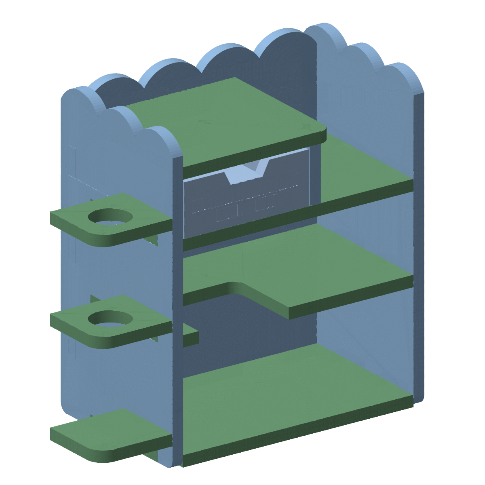

# דגם עגלה רפואית מפרספקס 4 מ"מ – חיבור לשונית-חריץ

## מידות
- גובה 110 מ"מ (בלי רגליים: הדפנות והגב נגמרים בדיוק בתחתית המדף התחתון), רוחב 95 מ"מ, עומק 60 מ"מ. עם מדפי הבלון בצד השמאלי, הרוחב הכולל הוא כ-127 מ"מ.
- 16 חלקים מפרספקס 4 מ"מ, על משטח של 300×252 מ"מ.
- המוצרים (משאבה, בלון חמצן, מכשיר אדים, עמוד אינפוזיה ושקעים) לא כלולים.

## קבצים
| קובץ | תיאור |
|---|---|
| `wagon_cut.svg` | קובץ חיתוך, קווים אדומים 0.1 מ"מ, ביחידות מ"מ |
| `wagon_cut.dxf` | אותו קובץ חיתוך בפורמט DXF (שכבת CUT) |
| `wagon_labels.svg` / `.png` | מפת חלקים עם אותיות, להרכבה (לא לחיתוך) |
| `generate.py` | הסקריפט שמייצר את כל הקבצים. אפשר לשנות בו מידות |

## לפני החיתוך – חשוב
1. **מדדו את הפרספקס בקליבר.** פרספקס "4 מ"מ" יוצא בפועל בין 3.8 ל-4.3 מ"מ. אם המידה שונה, עדכנו את `T` ב-`generate.py` והריצו `python3 generate.py`.
2. החריצים רחבים ב-0.15 מ"מ מהלשוניות (פרמטר `C`). הקרן של הלייזר מוסיפה עוד כ-0.1 עד 0.2 מ"מ, והתוצאה היא חיבור צמוד שנכנס ביד.
   פרספקס לא נדחס ועלול להיסדק, לכן לא כדאי להכניס חלקים בכוח. מומלץ לחתוך קודם את חלק L1 (חזית המגירה) ואת L3 כבדיקה.
   - אם החיבור רופף מדי, הקטינו את `C` ל-0.05 או ל-0.
   - אם החיבור צפוף מדי, הגדילו את `C` ל-0.25.

## חלקים
| אות | חלק |
|---|---|
| A | דופן שמאל עם 3 גלים (עם חריצים למדפי הבלון) |
| B | דופן ימין עם 3 גלים |
| C | גב עם 4 גלים |
| D / E / F | מדף תחתון / אמצעי (עם פתח גדול בצד שמאל מקדימה, כמו בתמונה) / עליון |
| G | משטח עליון מעל המגירה – לוח חלק בלי לשוניות, מודבק |
| H | מחיצת המגירה |
| J1, J2, J3 | מדפי בלון: תחתון בלי חור, ושניים עם חור |
| L1–L5 | מגירה: חזית, גב, שתי דפנות ותחתית |

## סדר הרכבה
1. **שלד:** מניחים את דופן A על השולחן, עם החריצים כלפי מעלה. מכניסים לחריצים את מדפים D, E ו-F ואת הגב C.
   המדף התחתון D נכנס לשקעים פתוחים בתחתית הדפנות והגב, כך שהתחתית של כל העגלה ישרה.
2. מלבישים מלמעלה את דופן B על כל הלשוניות.
3. **תא המגירה:** מכניסים את המחיצה H לחריצים במדף F ובגב C.
4. **משטח עליון G – בהדבקה בלבד:** מניחים את G על המחיצה H, צמוד לדופן A ולגב C, ומדביקים בדבק אקריליק לאורך שלושת המגעים.
5. **מגירה:**
   - מכניסים את L5 (התחתית) לחריצים התחתונים בחזית L1 ובגב L2.
   - סוגרים מהצדדים עם L3 ו-L4.
   - מחליקים את המגירה לתא שמתחת למשטח G.
6. **מדפי הבלון:** מכניסים את J1, J2 ו-J3 לחריצים שבצד החיצוני של דופן A. כל מדף מחובר בלשונית אחת, לכן כדאי לשים בה טיפת דבק כדי שהמדף לא ייפול.

כל שאר החיבורים מתפרקים ומתחברים מחדש. כדי לחבר לצמיתות, שמים טיפה של דבק אקריליק (כמו Acrifix או דבק כלורופורם) בכל חיבור בעזרת מזרק.

## בדיקה
`generate.py` בונה את הדגם בתלת-ממד ובודק שאף שני חלקים לא נכנסים זה בזה. בנוסף נבדק שכל 24 חיבורי הלשונית-חריץ המתוכננים אכן מתחברים, ושהמגירה לא נוגעת בגוף העגלה. התוצאה: כל החיבורים תקינים.
